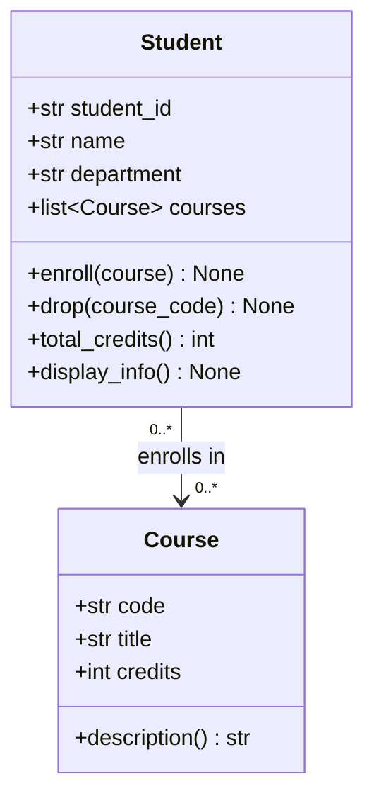

# Student Class Diagram: Mapping Design to Code

**Student:** Husnu Mert Onus  
**Course:** AII003 - Software Engineering

## Design

This example maps a Student-Course class diagram to Python.
No specific instructor-provided diagram was available during preparation;
the diagram below is the design assumed for this example.



A student can enroll in zero or more courses. The same Course object can
be referenced by multiple students. This is an association, not inheritance.
Enrollment is tracked on the Student side; Course does not store a roster.

## Mapping

| UML element | Python implementation |
| --- | --- |
| Classes | `class Student` and `class Course` |
| Attributes | Instance attributes initialized in `__init__` |
| Public visibility (+) | Public attributes and methods |
| Operations | Methods such as `enroll` and `drop` |
| Association | A list of Course objects inside Student |
| Instances | Objects constructed in `main.py` |

Duplicate enrollment, dropping an unknown course, and nonpositive course
credits raise ValueError. Course credits must be integers.

## Run

Requires Python 3.6 or newer; no external packages.

```bash
python main.py
```

On Windows, `py main.py` is another option when the launcher is installed.

The demonstration creates a fictional student, enrolls them in two
3-credit courses, displays their information (6 credits), then drops
AII302 and displays the remaining course (3 credits).

## Files

- `student.py`: Course and Student implementation.
- `main.py`: Example usage.

## Resources

- https://docs.python.org/3/tutorial/classes.html
- https://docs.python.org/3/tutorial/datastructures.html
